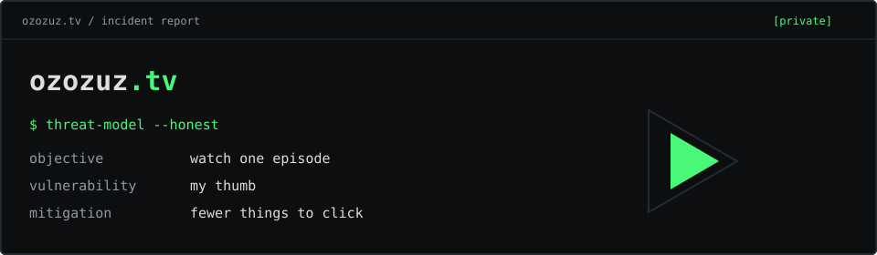

# ozozuz.tv

**An Android streaming client for when the weakest link is your own thumb.**

## Why Does This Exist?

Because my professional threat model did not account for my own thumb.

I could have called it a "hardened media consumption gateway" and put it on my CV.
Unfortunately, we all know I just wanted to watch South Park without accidentally
opening a second career in online gambling.

```text
Volevo solo guardare una puntata.
Ho aperto un casinò.
```



## What It Does

- Browse and search films and series in a native Android interface.
- Pick seasons and episodes without playing "guess the real Play button".
- Watch through the embedded player, with previous/next episode controls.
- Mark episodes as **Già vista**. Outsourcing memory is a feature.
- Download episodes as MP4 and play them locally.
- Change the catalogue domain from **dominio**, because even the website has commitment issues.

The catalogue pages stay out of the WebView. The video player stays in it,
with pop-ups and external navigation blocked. My thumb is on supervised release.

The launcher icon is a blonde punk succubus. The app supervises my clicks;
the branding department remains unsupervised.

## Install

**Android 8.0+** · Current version: **0.7.0**

Download [the APK](apk/ozozuz-tv-v0.7.0.apk), open it on your phone and allow
installation when Android asks. The app is called **ozozuz.tv**.

[APK SHA-256](apk/SHA256SUMS) · [Release notes](docs/releases/v0.7.0.md)

## Build

JDK 17, Android SDK 35, and the included Gradle wrapper:

```bash
./gradlew testDebugUnitTest assembleDebug
```

For the technical rabbit hole: [Android notes](docs/ANDROID.md) · [Validation history](VALIDATION.md).
