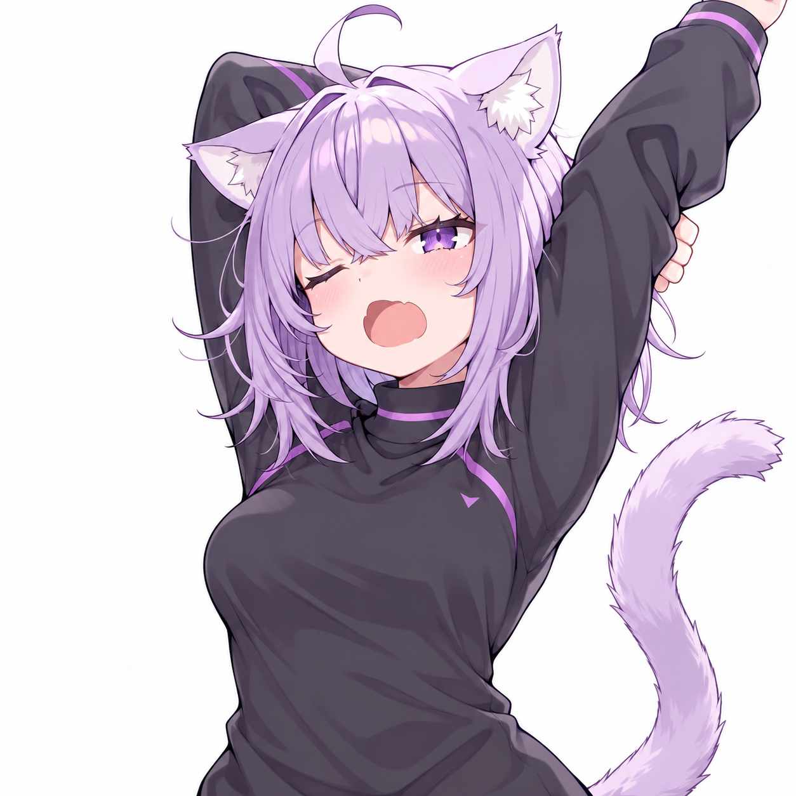

# ozozuz.tv

**An Android streaming client for when the weakest link is your own thumb.**

## Why Does This Exist?

Because my professional threat model did not account for my own thumb.

I could have called it a "hardened media consumption gateway" and put it on my CV.
Unfortunately, we all know I just wanted to watch South Park without accidentally
opening a second career in online gambling.

```text
Volevo solo guardare una puntata.
Ho aperto un casinò.
```


## What It Does

- Browse and search films and series without playing "guess the real Play button".
- Watch fullscreen, force landscape and keep the screen awake during playback.
- Save favourites and mark episodes as **Già vista**. Memory has been outsourced.
- Download episodes or whole seasons; manage and play them inside the app.
- Send videos to Google Cast. The television has been promoted.
- Change the catalogue domain from **dominio**. Commitment issues, apparently.

The player blocks pop-ups and external navigation. My thumb is on supervised release.



The app supervises my clicks; the branding department remains unsupervised.

## Get It Running

**Android 8.0+** · **0.10.0** · Sources only; no prebuilt APK in this tree.

Build with JDK 17, Android SDK 35 and the included Gradle wrapper:

```bash
./gradlew testDebugUnitTest assembleDebug
```

Install `app/build/outputs/apk/debug/app-debug.apk`, or grab the debug APK from a
successful [Actions run](https://github.com/Ozozuz/ozozuz.tv/actions).
Updating an existing installation requires the same signing key.

For the technical rabbit hole: [Android notes](docs/ANDROID.md) ·
[Source status](SOURCE_STATUS.md) · [Release notes](docs/releases/v0.10.0.md).
